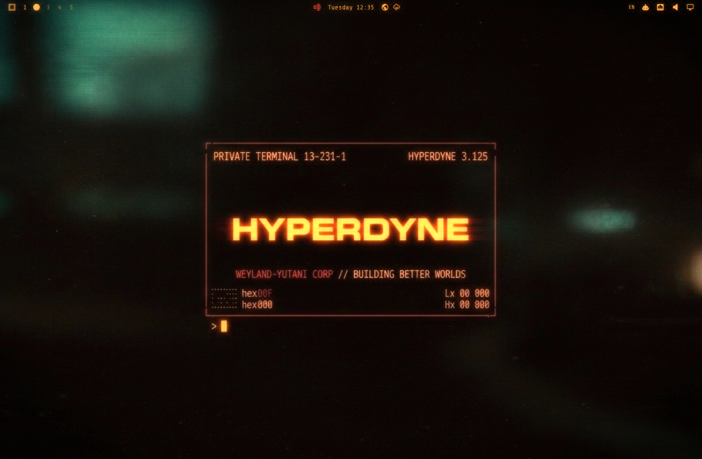
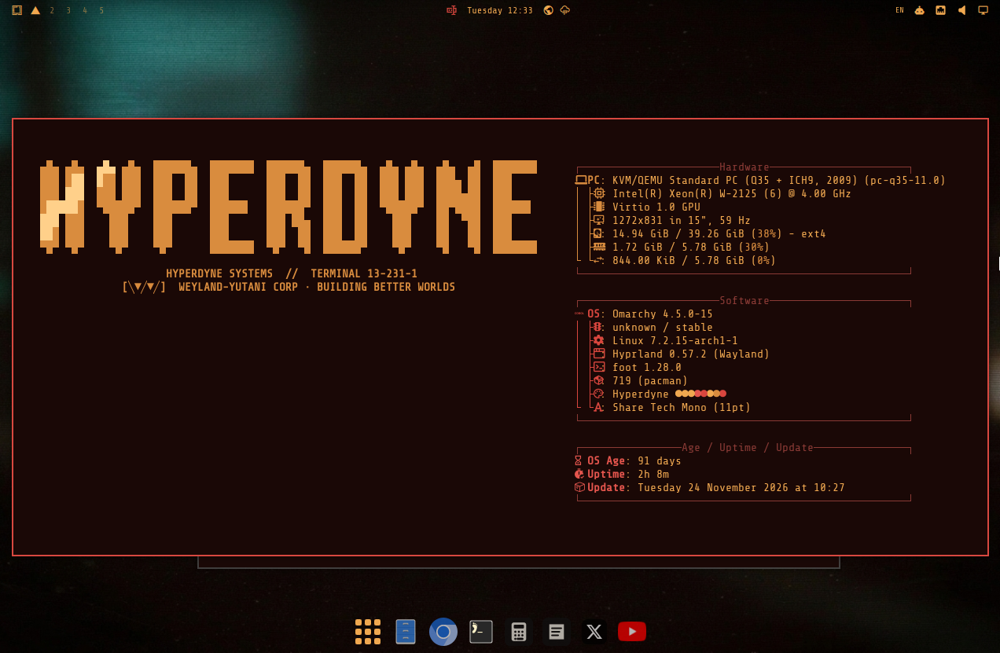
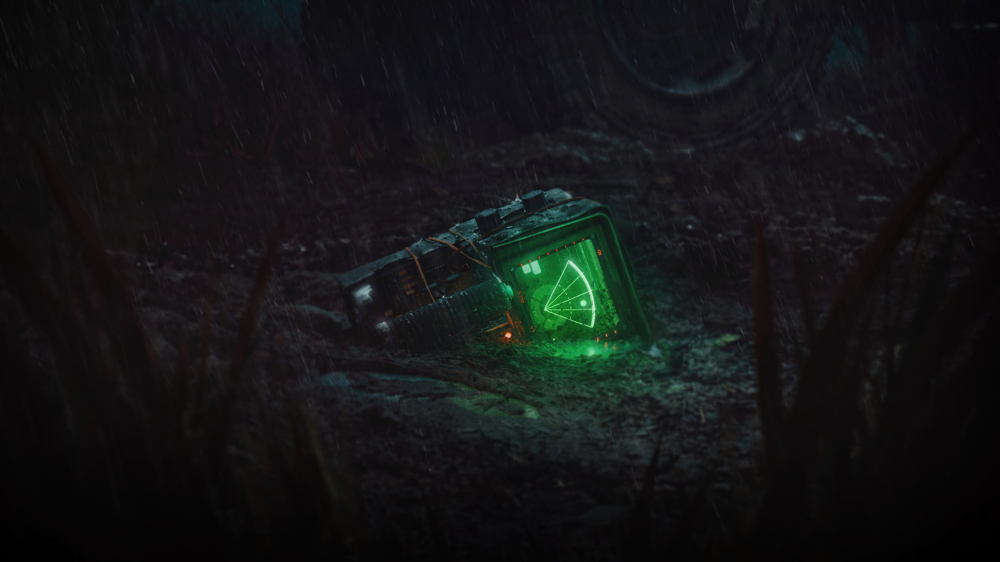
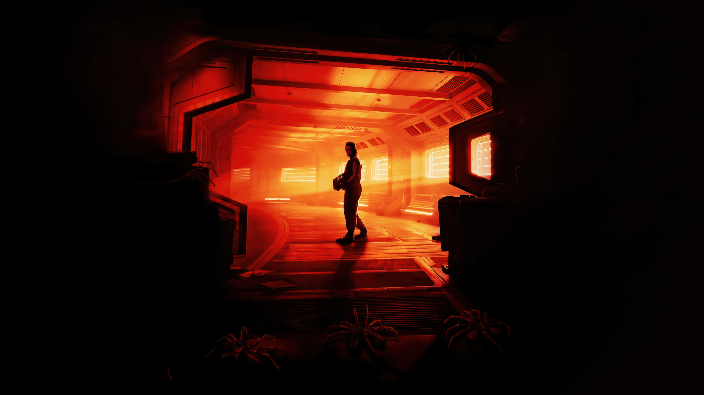
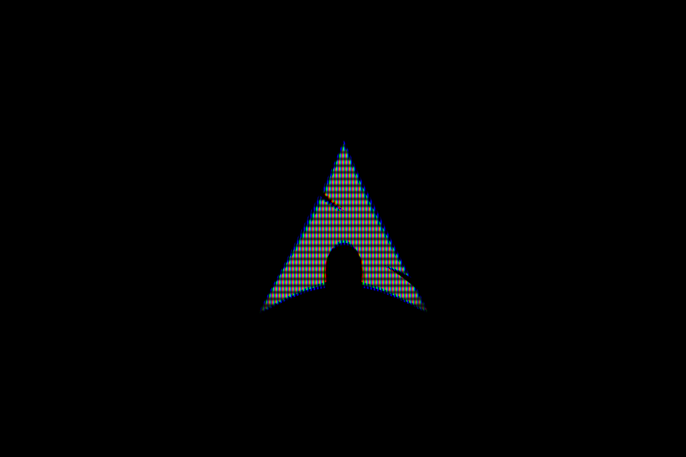

# Omarchy Hyperdyne Theme

An *Alien: Romulus* **Hyperdyne Systems** (`PRIVATE TERMINAL 13-231-1`) theme for [Omarchy](https://omarchy.org/).

## Screenshots

### Clean Workspace


### Terminal & Prompt


### System About


## Wallpapers

### Hyperdyne CRT


### Isolation


### Romulus


### Wallhaven CRT


## Summary: What Gets Installed & Effects

### Visual & CRT Effects
- **Shell-only CRT glow & scanlines**: `omarchy.bar` and `omarchy.menu` apply a warm amber `MultiEffect` phosphor glow and subtle tiled CRT scanlines directly to Omarchy shell elements, even when other apps are open.
- **Terminal-scoped CRT screen shader**: `crt-scanlines.glsl` adds a two-ring amber phosphor bloom, `11%` horizontal CRT scanlines, and a subtle edge vignette when a workspace has only terminal windows or the desktop/shell.
- **Smart auto-toggle (`crt-shader-watcher.sh`)**: Automatically disables the screen shader whenever a non-terminal app (such as a browser or IDE) is open on the active workspace, and temporarily disables partial damage tracking while the shader is active so the cursor never ghosts.

### Installed Components
- **Omarchy Theme (`~/.config/omarchy/themes/hyperdyne/`)**: Palette (`colors.toml`), shell/lock/menu/popup overrides (`shell.toml`), icons, preview, and Hyperdyne CRT wallpapers.
- **Font (`~/.local/share/fonts/`)**: `ShareTechMono-Regular.ttf` (`Share Tech Mono`), activated via `omarchy font set`.
- **Shell Plugins (`~/.config/omarchy/plugins/`)**: Custom `omarchy.bar` and `omarchy.menu` plugins with phosphor glow and scanlines.
- **Hyprland Shader & Watcher (`~/.config/hypr/`)**: `shaders/crt-scanlines.glsl`, `scripts/crt-shader-watcher.sh`, `crt-shader-state.lua` (sourced from `looknfeel.lua`), and autostart entry in `autostart.lua`.
- **Branding (`~/.config/omarchy/branding/`)**: Custom `HYPERDYNE` block-art logos for the About window (`about.txt`) and screensaver (`screensaver.txt`).
- **Terminal, Prompt & System Monitor**:
  - `~/.config/foot/foot.ini` (`Share Tech Mono` size 11, 18px padding)
  - `~/.config/starship.toml` (red/amber prompt with `> ` symbol)
  - `~/.config/omarchy/hyperdyne-banner.sh` (interactive shell startup banner, sourced in `~/.bashrc`)
  - `~/.config/btop/btop.conf` (square corners, block-style graphs)
- **Plymouth Bootsplash (optional, requires `sudo`)**: `plymouth/hyperdyne/` bootsplash & LUKS unlock theme in `#080201` / `#e44543` / `#da9000` (installed if `plymouth` is present).

## Install on Your Omarchy Laptop
```bash
git clone https://github.com/Xkalin1990/omarchy-hyperdyne-theme.git
cd omarchy-hyperdyne-theme
chmod +x install.sh
./install.sh
```
