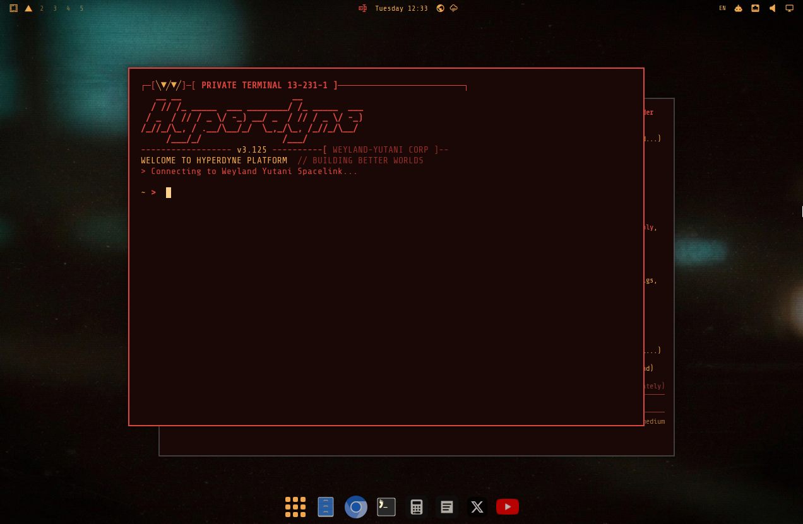
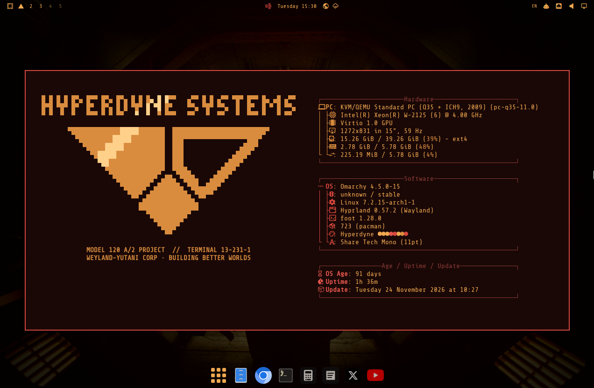
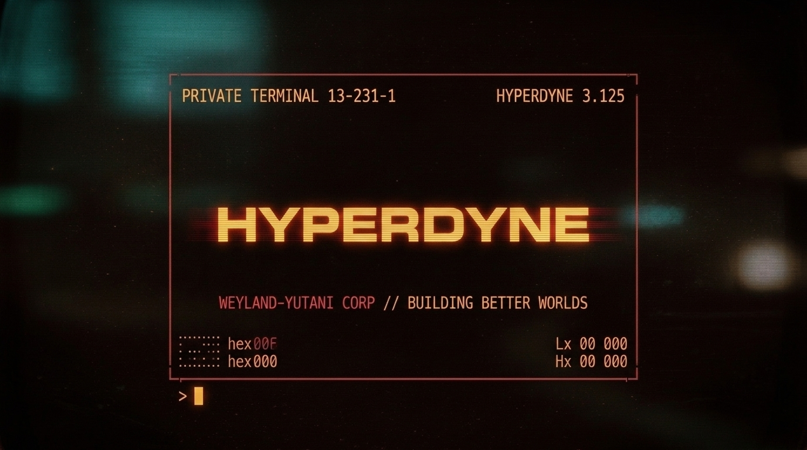
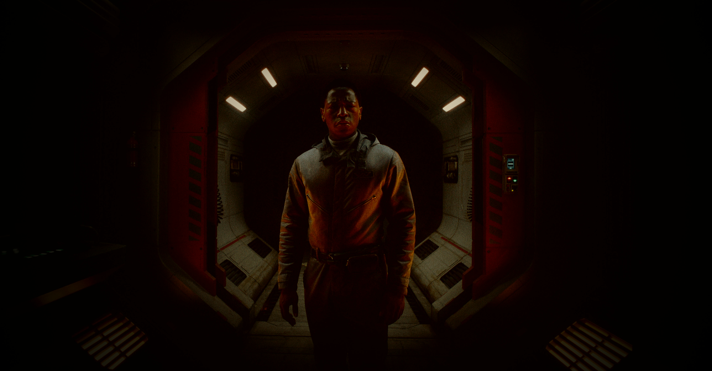

# Omarchy Hyperdyne Theme

An *Alien: Romulus* **Hyperdyne Systems** (`PRIVATE TERMINAL 13-231-1`) theme for [Omarchy](https://omarchy.org/).

Inspired by the retro-futuristic Weyland-Yutani hardware terminals of *Alien: Romulus*, this theme transforms your Omarchy desktop into an amber-and-crimson CRT workstation. It pairs a deep `#1a0806` phosphor-black palette with warm `#f0a850` amber text, `#d9463e` crimson accents, and `Share Tech Mono` typography across the bar, menus, terminal, prompt, and system monitor.

To complete the vintage hardware feel without sacrificing daily usability, the theme includes custom Qt Quick shell plugins with phosphor glow and scanlines, a terminal-scoped Hyprland CRT shader that automatically disables itself when graphical apps like browsers or IDEs are open, custom Hyperdyne Systems `about` & screensaver branding, curated CRT wallpapers, and an optional Plymouth bootsplash.

## Screenshots

### Clean Workspace


### Terminal & Prompt


### System About


## Wallpapers

### Hyperdyne CRT


### Isolation


### Romulus


### Wallhaven CRT


### Android (Dark)


## Summary: What Gets Installed & Effects

### Visual & CRT Effects
- **Shell-only CRT glow & scanlines**: `omarchy.bar` and `omarchy.menu` apply a warm amber `MultiEffect` phosphor glow and subtle tiled CRT scanlines directly to Omarchy shell elements, even when other apps are open.
- **Terminal-scoped CRT screen shader**: `crt-scanlines.glsl` adds a two-ring amber phosphor bloom, `11%` horizontal CRT scanlines, and a subtle edge vignette when a workspace has only terminal windows or the desktop/shell.
- **Smart auto-toggle (`crt-shader-watcher.sh`)**: Automatically disables the screen shader whenever a non-terminal app (such as a browser or IDE) is open on the active workspace, and temporarily disables partial damage tracking while the shader is active so the cursor never ghosts.

### Installed Components
- **Omarchy Theme (`~/.config/omarchy/themes/hyperdyne/`)**: Palette (`colors.toml`), shell/lock/menu/popup overrides (`shell.toml`), icons, preview, and Hyperdyne CRT wallpapers. Cycle wallpapers with `omarchy theme bg next`.
- **Font (`~/.local/share/fonts/`)**: `ShareTechMono-Regular.ttf` (`Share Tech Mono`), activated via `omarchy font set`.
- **Shell Plugins (`~/.config/omarchy/plugins/`)**: Custom `omarchy.bar` and `omarchy.menu` plugins using Qt Quick `MultiEffect` phosphor glow and scanlines (existing plugins are backed up to `.bak`).
- **Hyprland Shader & Watcher (`~/.config/hypr/`)**: `shaders/crt-scanlines.glsl`, `scripts/crt-shader-watcher.sh`, `crt-shader-state.lua` (sourced from Omarchy's `looknfeel.lua`), and autostart entry in `autostart.lua`. Requires `jq` and `socat`.
- **Branding (`~/.config/omarchy/branding/`)**: Custom `HYPERDYNE` block-art logos for the About window (`about.txt`) and screensaver (`screensaver.txt`).
- **Terminal, Prompt & System Monitor**:
  - `~/.config/foot/foot.ini` (`Share Tech Mono` size 11, 18px padding)
  - `~/.config/starship.toml` (red/amber prompt with `> ` symbol)
  - `~/.config/omarchy/hyperdyne-banner.sh` (interactive shell startup banner, sourced in `~/.bashrc`)
  - `~/.config/btop/btop.conf` (square corners, block-style graphs)
- **Plymouth Bootsplash (optional, requires `sudo`)**: `plymouth/hyperdyne/` bootsplash & LUKS unlock theme in `#1a0806` / `#e44543` / `#da9000` (installed automatically with `sudo` if `plymouth-set-default-theme` is present).

## Prerequisites
- [Omarchy](https://omarchy.org/) (`omarchy` CLI, Hyprland, `foot`, `starship`, `btop`)
- `jq` and `socat` (for the terminal-scoped CRT shader watcher)

## Install on Your Omarchy System

```bash
git clone https://github.com/Xkalin1990/omarchy-hyperdyne-theme.git
cd omarchy-hyperdyne-theme
chmod +x install.sh uninstall.sh
./install.sh
```

## Uninstall

```bash
./uninstall.sh
omarchy theme set <other-theme>
```
